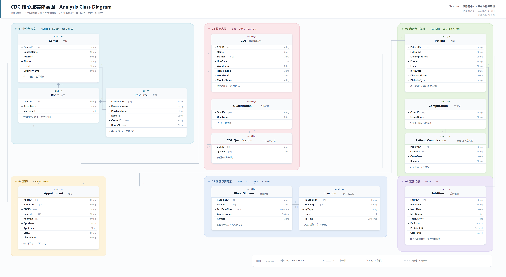
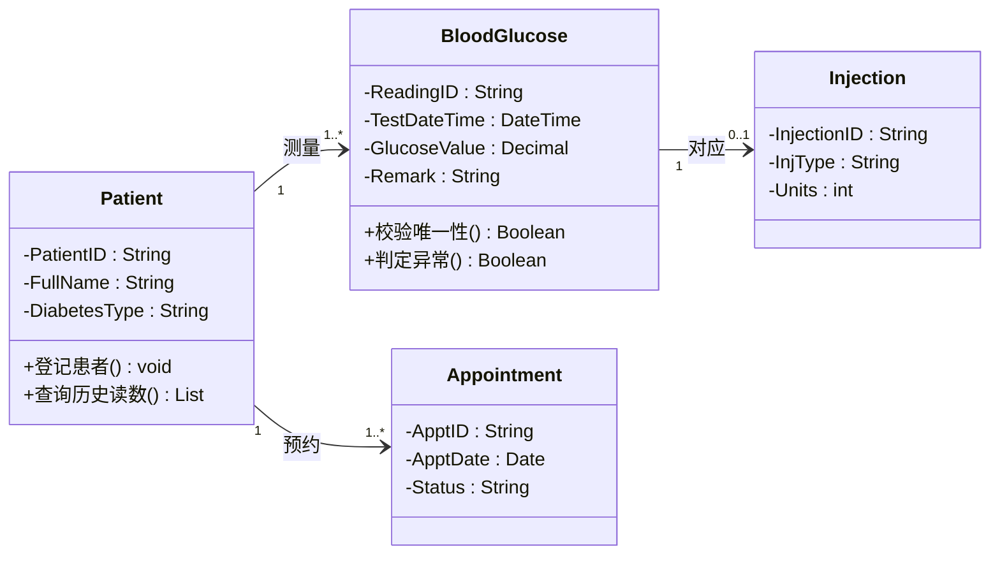
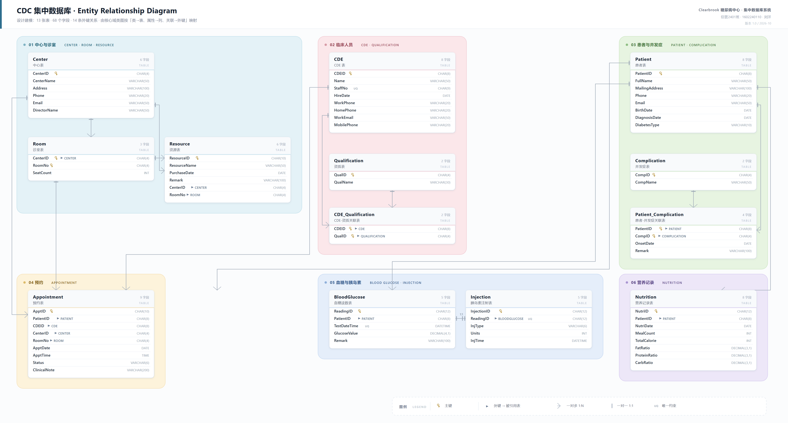
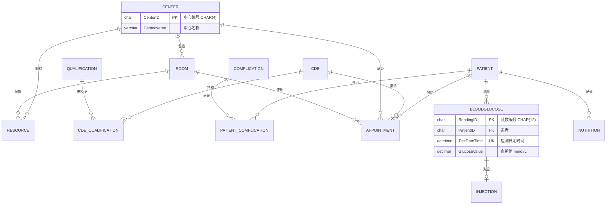

# Clearbrook 糖尿病中心 · 集中数据库系统 —— 类图与数据库图表

> 信管 2401 班 · 1602240110 · 刘洋
> 本仓库是《Clearbrook 糖尿病中心集中数据库系统设计报告》的配套交付：
> 完整报告见 [`report/1602240110刘洋.docx`](report/1602240110刘洋.docx)，
> 其中的第四章「分析建模」配 **UML 类图**、第五章「设计建模」配 **关系数据库 ERD**，
> 图形与报告里的 13 张表设计逐字段一致。

---

## 一、两张图的关系

建模工作流：**业务建模 → 需求建模 → 分析建模 → 设计建模**。
本仓库承接后半段，把「系统里有什么」翻译成「库里有什么」：

| 对象模型概念 | 关系数据库概念 | 本仓库中的体现 |
| --- | --- | --- |
| 类 Class | 表 Table | 13 个实体类 → 13 张表 |
| 属性 Attribute | 列 Column | 68 个属性 → 68 个字段 |
| 对象 Object | 行 Row | —— |
| 普通关联 1:N | 外键放在「多」方 | 14 条外键约束 |
| 组合 Composition | 外键放在非 1 方且非空 | `Room → Center`、`Resource → Room` |
| 多对多 N:M | 单独建关联表 | `CDE_Qualification`、`Patient_Complication` |

只要类图建对，映射出的表结构自然满足 1NF（原子属性）、2NF（消除部分依赖）、3NF（消除传递依赖）。

---

## 二、UML 类图（分析建模 · 核心域实体类）



<details>
<summary>点开看 Mermaid 源码（GitHub 自动渲染为可交互矢量图）</summary>



完整版见 [`diagrams/src/class-diagram.mmd`](diagrams/src/class-diagram.mmd)（13 个类、14 条关联）。
</details>

**读图要点**

- 三类分析类中，本图只画**实体类**（保留核心域数据），边界类与控制类在报告第四节已用表格说明；
- `Room` 与 `Resource` 左上角是**实心菱形**——组合关系，表示诊室、资源离开中心/诊室就没有独立意义；
- `BloodGlucose "1" —— "0..1" Injection`：一次读数最多对应一次注射，且并非每次读数都有注射；
- `CDE_Qualification`、`Patient_Complication` 是**关联类**，承载多对多关系上的属性（如 `OnsetDate`）。
- 类图属性标注的是**领域类型**（String / Date / Decimal），落到数据库时的 SQL 类型（CHAR(8)、DECIMAL(3,1) 等）在 ERD 与 DDL 中给出——这正是「分析模型 → 设计模型」精化的一步。

---

## 三、数据库 ERD（设计建模）



<details>
<summary>点开看 Mermaid 源码</summary>



完整版（含全部 68 个字段）见 [`diagrams/src/er-diagram.mmd`](diagrams/src/er-diagram.mmd)。
</details>

**图例**

| 标记 | 含义 |
| --- | --- |
| 🔑 金色钥匙 | 主键 Primary Key |
| ➤ 箭头 + 表名 | 外键，指向被引用表 |
| 鸦爪 ⋀ | 一对多的「多」端 |
| 短竖线 ｜ | 「恰一」端；双竖线表示强制一对一 |
| 色块分区 | 6 个业务域：中心诊室 / 临床人员 / 患者 / 预约 / 血糖 / 营养 |

---

## 四、13 张表速查

| # | 表名 | 中文名 | 主键 | 外键 | 所在模块 |
| --- | --- | --- | --- | --- | --- |
| 1 | `Center` | 中心表 | CenterID | — | 中心与诊室 |
| 2 | `Room` | 诊室表 | CenterID + RoomNo | CenterID → Center | 中心与诊室 |
| 3 | `Resource` | 资源表 | ResourceID | (CenterID, RoomNo) → Room | 中心与诊室 |
| 4 | `CDE` | 糖尿病教育师表 | CDEID | — | 临床人员 |
| 5 | `Qualification` | 资质表 | QualID | — | 临床人员 |
| 6 | `CDE_Qualification` | CDE-资质关联表 | CDEID + QualID | 双向 | 临床人员 |
| 7 | `Patient` | 患者表 | PatientID | — | 患者 |
| 8 | `Complication` | 并发症表 | CompID | — | 患者 |
| 9 | `Patient_Complication` | 患者-并发症关联表 | PatientID + CompID | 双向 | 患者 |
| 10 | `Appointment` | 预约表 | ApptID | PatientID / CDEID / (CenterID, RoomNo) | 预约 |
| 11 | `BloodGlucose` | 血糖读数表 | ReadingID | PatientID → Patient | 血糖 |
| 12 | `Injection` | 胰岛素注射表 | InjectionID | ReadingID → BloodGlucose | 血糖 |
| 13 | `Nutrition` | 营养记录表 | NutriID | PatientID → Patient | 营养 |

建表语句见 [`schema/cdc_schema.sql`](schema/cdc_schema.sql)（含 6 条关键业务规则对应的约束）。

### 关键设计决策

1. **代理主键 + 业务唯一键**
   领域字段会变，所以每张表都设独立主键，再给有业务含义的组合字段加唯一约束。
   例：`BloodGlucose` 主键是 `ReadingID`，同时 `(PatientID, TestDateTime)` 唯一。
2. **组合主键只在从属表使用**
   `Room` 用 `(CenterID, RoomNo)` 天然区分不同中心下的同名诊室；`Appointment` 仍用单列代理键，避免下游表键值膨胀。
3. **一对一写成「外键 + 唯一约束」**
   `Injection.ReadingID` 加 `UNIQUE`，既表达 1:0..1，又不引额外的表。
4. **状态用取值受限的短字符串**
   `Appointment.Status ∈ {到诊, 改期, 取消}`，配 `CHECK` 约束；课程范围内不引入字典表。

---

## 五、目录结构

```
cdc-erd/
├─ README.md                     ← 本文件（GitHub 上直接看）
├─ report/
│  └─ 1602240110刘洋.docx        ← 设计报告全文（含图 4-1、图 5-1）
├─ diagrams/
│  ├─ class-diagram.svg/.png     ← UML 类图（矢量 + 高清位图）
│  ├─ erd.svg/.png               ← 数据库 ERD
│  └─ src/
│     ├─ class-diagram.mmd       ← Mermaid 类图源码
│     └─ er-diagram.mmd          ← Mermaid ERD 源码
├─ schema/
│  └─ cdc_schema.sql             ← 建表 DDL
└─ build/
   ├─ make_diagrams.py           ← 图形生成脚本
   └─ build_all.py               ← 一键重建 SVG + PNG
```

重新生成图形：

```bash
cd build
python make_diagrams.py     # 输出 SVG
# PNG 由 Edge 无头截图生成，见 build_all.py
```

依赖：Python 3.10+、`pillow`（文字宽度测量）、Edge/Chrome（SVG→PNG）。

---

## 六、与报告的对应关系

| 报告章节 | 本仓库内容 |
| --- | --- |
| 全文 | `report/1602240110刘洋.docx` |
| 四、分析建模 · 核心域实体类清单 | `diagrams/class-diagram.png`（报告图 4-1） |
| 五、设计建模 · 1. 从分析到设计的映射 | README 第一节映射表 |
| 五、设计建模 · 2. 主键设计 | `schema/cdc_schema.sql` 注释 + 第四节决策说明 |
| 五、设计建模 · 3. 数据库表设计 | `diagrams/erd.png`（报告图 5-1）、`schema/cdc_schema.sql` |
| 五、设计建模 · 4. 关键业务规则 | README 第四节 + SQL 末尾 R1–R6 |
